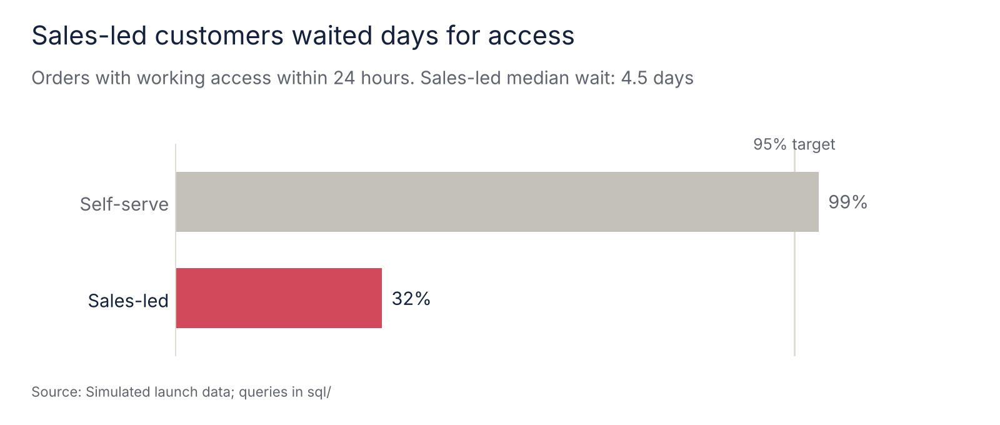
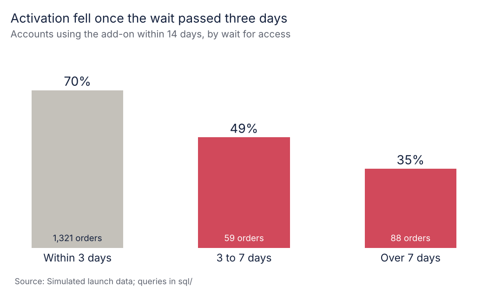

# GTM Launch Playbook: Harbor Assist

**In one line:** a full launch plan for a new paid add-on, from planning to a 90-day review, which found one rule that slowed down every sales-led customer.

This shows how I'd run a product launch across several teams (product, sales, marketing, billing, support). It uses a fictional software company, Harbor Docs, launching an AI add-on that customers can buy on their own online or through a salesperson. Everything is made up, including the data.

## What I found

- **Overall, the launch hit three of its four goals**
- **Customers who bought through sales missed all four.** They only got access after their invoice was paid, so the typical customer waited 4.5 days
- **Waiting hurt.** Customers who waited more than three days were far less likely to start using the add-on, which cost about 43 customers who never got going



**How to read it:** the bars show the share of orders with working access within 24 hours. Self-serve customers hit 99%; sales-led customers only 32%.



## What I'd do

1. Give access as soon as a deal is signed, for customers who pay their bills on time
2. Fix the billing rule for customers who add the product mid-contract
3. Report every launch goal separately for self-serve and sales-led customers from day one

## What's in it

A launch plan you can reuse: the brief, requirements, who owns what, risks, a launch checklist, a testing plan and the 90-day review, all listed in the full section below.

## Words used here

- **GTM (go-to-market):** everything needed to launch and sell a product
- **Activation:** a customer actually starting to use what they bought

<details>
<summary><b>The full analysis: method, detail and how to run it</b> (for technical readers)</summary>

## The result

The launch met three of four success criteria overall, but **sales-led customers missed all four**. The cause was a launch decision: sales-led customers only got access once their invoice was paid, so the median customer waited 4.5 days. Customers who waited more than three days were far less likely to use the add-on.

**Recommendation:** grant access on booking for customers in good standing, fix the proration rule for mid-term additions, and report every success metric by channel from day one. Full detail in the [90-day readout](docs/07_post_launch_readout.md).

## What's in the repo

| Document | What it shows |
|---|---|
| [01 Program brief](docs/01_program_brief.md) | Goal, scope, success criteria, timeline and team |
| [02 Business requirements](docs/02_business_requirements.md) | 14 requirements with owners, priorities and acceptance criteria |
| [03 RACI and decision log](docs/03_raci_and_decisions.md) | Who owns what, and each decision with the tradeoff accepted |
| [04 Dependencies and risks](docs/04_dependencies_and_risks.md) | How one order moves through each system, plus dependency and risk registers |
| [05 Launch readiness](docs/05_launch_readiness.md) | Readiness checklist, go / no-go criteria and hypercare plan |
| [06 UAT plan](docs/06_uat_plan.md) | Test cases, and the gap UAT missed |
| [07 90-day readout](docs/07_post_launch_readout.md) | Results against each success criterion, findings and recommendations |
| [project/backlog.csv](project/backlog.csv) | The program as milestones and issues, ready for a GitHub Projects board |
| [sql/](sql/) | DuckDB queries behind every number in the readout |

## How the program ran

| Phase | Key output |
|---|---|
| Discovery | Scope and four success criteria agreed with the sponsor |
| Requirements | 14 business requirements, each with one accountable owner |
| Build | Dependencies tracked across Product, Sales Ops, Finance and Engineering |
| UAT | 14 test cases signed off by their owners |
| Go / no-go | Launch approved with one known risk accepted and monitored |
| Launch and hypercare | Daily issue review for two weeks, then hand-off to owners |
| 90-day readout | Results by channel, root causes and a decision request |

## What I'd do differently

- **Challenge the access-on-payment decision harder at requirements.** The risk was logged, but nobody estimated how long customers actually take to pay
- **Report by channel from day one.** The blended scorecard looked fine; the channel split showed the problems
- **Test pricing rules on more than one date.** One test case on a month-end date let a proration bug through

## Reproduce

```bash
pip install -r requirements.txt
python src/generate_data.py   # writes data/accounts.csv and data/orders.csv
python src/run_analysis.py    # runs sql/, writes results/ and images/
```

## Skills shown

Program management, business requirements, stakeholder alignment (RACI), dependency and risk management, UAT planning, launch readiness, quote-to-cash and entitlement process design, SQL (DuckDB), Python, and outcome measurement.

</details>
