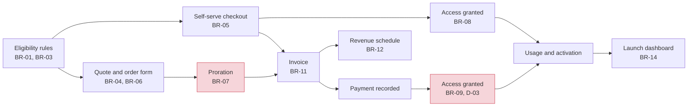

# 04. Dependency Map and Risks

## How a single order moves through the systems

A change at any step affects every step after it. The two steps marked in red are where the launch ran into trouble.

## Dependency register

| ID | This work | Depends on | Owner of the dependency | Needed by | Status at go / no-go |
|---|---|---|---|---|---|
| DEP-01 | Quote tool line item | Final price and discount rules (BR-02, BR-04) | Finance | 23 Jan | Done |
| DEP-02 | Proration on amendments | Contract term dates available in the quote tool | Sales Ops | 30 Jan | Done |
| DEP-03 | Sales-led access | Payment status sent from billing to the entitlement service | Finance Systems, Engineering | 6 Feb | Done |
| DEP-04 | Launch dashboard | Order, payment and access timestamps (BR-13) | Engineering | 13 Feb | Done |
| DEP-05 | Sales enablement | Final pricing and the quote walkthrough | Sales Ops | 18 Feb | Done |
| DEP-06 | Support macros | Known issues list from UAT | Program lead | 25 Feb | Done |

## Risk register

| ID | Risk | Likelihood | Impact | Mitigation | Owner | Status after launch |
|---|---|---|---|---|---|---|
| R-01 | Self-serve checkout fails under launch-day load | Low | High | Load test in UAT; rollback switch ready | Engineering | Did not occur |
| R-02 | Sales-led customers wait days for access because access waits for payment (D-03) | Medium | High | Daily report on orders paid but not yet live; AEs warned to set expectations | Program lead | **Occurred.** Median wait 4.5 days |
| R-03 | Proration errors on mid-term additions | Low | Medium | UAT test case TC-09 | Finance | **Occurred.** 12.3% of mid-term orders billed wrong |
| R-04 | Sales team not ready to position the add-on | Medium | Medium | Enablement session and talk track one week before launch | Enablement | Partly occurred (see readout) |
| R-05 | Dashboard data incomplete at launch | Low | Medium | Field completeness check in UAT (TC-14) | Analytics | Did not occur |
