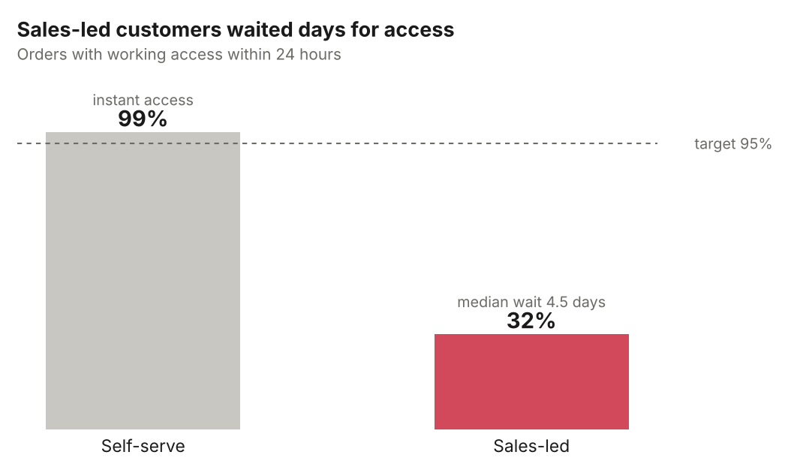
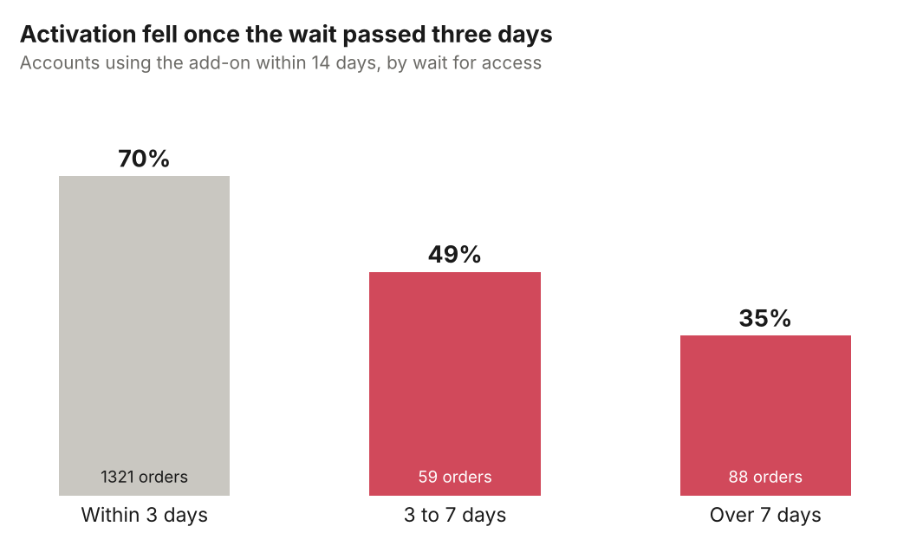

# 07. 90-Day Readout

**Period:** 2 March to 31 May 2026 &nbsp;|&nbsp; **Prepared for:** VP Revenue Operations &nbsp;|&nbsp; **Data:** simulated, see [src/generate_data.py](../src/generate_data.py)

## Summary

The launch met three of four success criteria overall, but **sales-led customers missed all four**. The main cause was a launch decision (D-03): sales-led customers only got access once their invoice was paid, so most waited days. Accounts that waited more than three days were much less likely to use the add-on.

**Recommendation:** give sales-led customers in good standing access when the order is booked, not when it is paid (proposed decision D-06), and fix the proration rule for mid-term additions.

## Scorecard

| Criterion | Target | Overall | Self-serve | Sales-led |
|---|---|---|---|---|
| SC-1 Attach rate (90 days) | 8% or higher | 8.7% | 9.9% | **5.5%** |
| SC-2 Activation within 14 days | 60% or higher | 67.3% | 70.5% | **52.0%** |
| SC-3 Access within 24 hours | 95% or higher | **87.2%** | 98.7% | **31.7%** |
| SC-4 Billing error rate | Under 1% | 0.7% | 0.2% | **3.2%** |

Bold = target missed. Source: [sql/05_scorecard.sql](../sql/05_scorecard.sql)

The overall numbers look healthy because self-serve makes up 83% of orders. Reporting only the blended figures would have hidden every sales-led problem.

## Finding 1: sales-led customers waited days for access

- 98.7% of self-serve orders had access within 24 hours; only 31.7% of sales-led orders did
- The median sales-led customer waited **4.5 days**, and 1 in 10 waited more than 13 days
- This was a known risk (R-02) accepted at go / no-go. The wait turned out longer than expected because most customers pay invoices on standard payment terms, not on signing

Source: [sql/02_time_to_access.sql](../sql/02_time_to_access.sql)

## Finding 2: longer waits meant lower activation

| Wait for access | Orders | Activated within 14 days |
|---|---|---|
| Within 3 days | 1,321 | 70.2% |
| 3 to 7 days | 59 | 49.2% |
| Over 7 days | 88 | 35.2% |

- **147 orders** waited more than three days and 60 of them activated
- At the same rate as faster orders, about 103 would have activated: an estimated **43 activations lost**
- This is an estimate from observed data, not a controlled test. Customers who pay slowly may also differ in other ways, so the true effect could be smaller

Sources: [sql/03_activation_by_wait.sql](../sql/03_activation_by_wait.sql), [sql/06_impact_estimate.sql](../sql/06_impact_estimate.sql)

## Finding 3: mid-term additions were billed wrong

| Order type | Orders | Billing errors | Error rate |
|---|---|---|---|
| New term | 1,403 | 2 | 0.1% |
| Mid-term addition | 65 | 8 | **12.3%** |

- The quote tool prorated by month while billing prorated by day (BR-07), so the two disagreed whenever an addition landed mid-month
- UAT test TC-09 passed because it used a month-end date, where both methods agree (see [06_uat_plan.md](06_uat_plan.md))
- Each error needed a credit note and a support ticket

Source: [sql/04_billing_accuracy.sql](../sql/04_billing_accuracy.sql)

## Finding 4: sales-led attach rate was lower

Sales-led attach was 5.5% against 9.9% for self-serve. The access delay explains part of the activation gap, but not the attach gap, since customers had already bought. Possible causes to test next:

- Longer procurement for larger accounts
- Account executives prioritising core renewals over the add-on (enablement feedback suggests this)
- The 15% discount approval threshold slowing larger deals

## Recommendations

| # | Action | Owner | Effort | Expected effect |
|---|---|---|---|---|
| 1 | Grant sales-led access on booking for customers with no overdue invoices; suspend automatically after 30 days unpaid (D-06) | Engineering, Finance | Medium | SC-3 for sales-led from 31.7% toward 95%; recover a share of the ~43 lost activations each quarter |
| 2 | Align proration to daily in the quote tool, and re-test with TC-09b and TC-09c | Sales Ops, Finance | Low | SC-4 for mid-term additions under 1% |
| 3 | Report every success criterion by channel on the launch dashboard by default | Analytics | Low | Channel problems are visible in week one, not at day 90 |
| 4 | Interview 8 to 10 account executives and review lost add-on deals to explain the attach gap | Program lead, Enablement | Low | A tested plan to lift sales-led attach |
| 5 | Add a three-date rule to UAT for every pricing and billing change | Program lead | Low | Prevents the TC-09 gap on future launches |

## Decision needed

Approve **D-06**: grant sales-led customers in good standing access when the order is booked. Finance's original concern (unpaid usage) is covered by limiting it to customers with no overdue invoices and by automatic suspension after 30 days.
